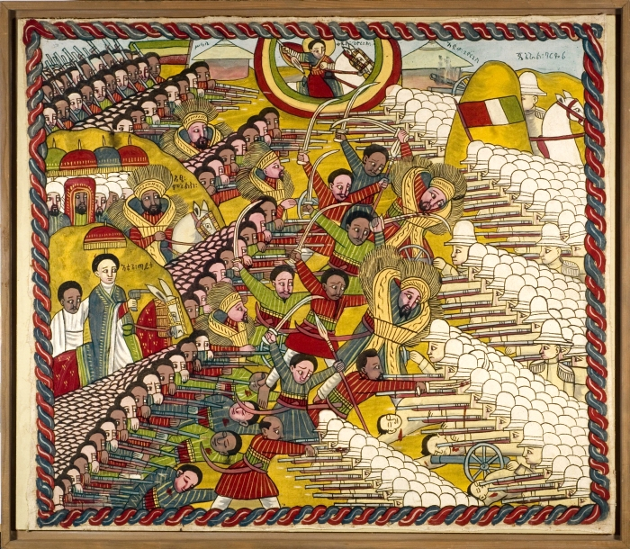

# 06 - I primi passi del Regno di Italia. Destra e Sinistra storica

[⬅ Torna all'indice](../README.md)

## Immagini

### Pio IX contro Unità

### Italia tassa sul macinato

### COLLECTIE TROPENMUSEUM De slag bij Adua TMnr 5956-2

### Depretis e il trasformismo

